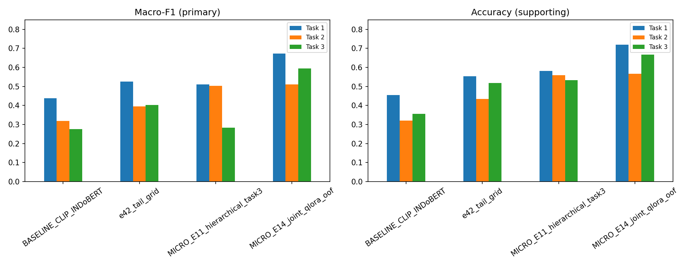

# Tempo — CLIP–IndoBERT MTL dan XAI

Paket client untuk penelitian dekoding metafora sampul majalah Tempo pada 740 sampel, tiga task, dan lima fold. Model utama penelitian adalah E42 CLIP-L14–IndoBERT joint MTL. Metrik utama menggunakan Macro-F1.

Repository ini telah dibersihkan dari nama pribadi, username akun, alamat home personal, tautan akun pribadi, metadata author lama, credential, cache, dan identitas partisipan. Referensi layanan eksternal menggunakan placeholder netral dan tidak dimaksudkan sebagai tautan aktif.

## Hasil utama

| Model | Macro-F1 Task 1 | Task 2 | Task 3 | Peran |
|---|---:|---:|---:|---|
| E42 CLIP–IndoBERT | 0.525483 | 0.395560 | 0.403398 | Model utama penelitian |
| MICRO-E14 Qwen3-VL QLoRA | 0.673321 | 0.510282 | 0.595480 | Model pembanding |
| QLoRA basic supporting text | 0.684652 | 0.492739 | 0.590929 | Kontrol R21 |

MICRO-E14 mempunyai Micro-F1 Task 1/2/3 sebesar 0.720270/0.566216/0.667568. Basic supporting text dan arm literal citra+judul merupakan eksperimen berbeda.



## Struktur paket

- `DEMO_XAI_745_FULL/`: source notebook, eksperimen, web demo, data, dan protokol.
- `DEMO_XAI_745_FULL/06_models/e42-tail-grid-v1/`: lima checkpoint E42, cache front, konfigurasi, dan manifest checksum yang langsung ikut dalam clone.
- `delivery/HASIL_REVISI_JOY_20261108_R4/`: paket analisis utama dengan notebook, tabel, bukti revisi, dan manifest.
- `delivery/ADDENDUM_R21_LITERAL_20261110/`: hasil kontrol R21 literal.
- `delivery/ADDENDUM_HASIL_MANUSIA_20261110/`: hasil R22, R23/R6, R31, serta audit R34/R9.
- `docs/revisi-ii/`: penjelasan metodologi, keputusan revisi, bukti E42, dan tracker.
- `tools/`: utilitas verifikasi tambahan.

## Menjalankan verifikasi

Gunakan Python 3.10:

```bash
python3 -m venv .venv
source .venv/bin/activate
python -m pip install -r DEMO_XAI_745_FULL/01_notebook/revisi_ii/requirements-analysis-lock.txt
python delivery/HASIL_REVISI_JOY_20261108_R4/tools/validate_package.py \
  --root delivery/HASIL_REVISI_JOY_20261108_R4
```

Untuk tes analisis:

```bash
cd DEMO_XAI_745_FULL/01_notebook/revisi_ii
python -m unittest -v \
  test_evaluate test_human_agreement test_open_followup \
  test_qwen_headline test_technical_delivery
```

Notebook analisis tersedia pada `delivery/HASIL_REVISI_JOY_20261108_R4/notebooks/`. Run all analisis memakai CPU tanpa API atau credential. Training dan XAI ulang memerlukan model/cache serta environment ML yang dirujuk oleh protokol.

Web demo memakai E42 secara default. Jalankan `DEMO_XAI_745_FULL/02_web_demo/app.py`; startup memverifikasi checksum lima checkpoint. Backbone CLIP-L14 dan IndoBERT diunduh pada pemakaian pertama berdasarkan revision/hash yang dipin. Set `TEMPO_OFFLINE=1` bila cache backbone sudah tersedia dan jaringan harus dinonaktifkan.

## Status revisi

R22, R23/R6, dan R31 telah ditutup secara konservatif tanpa mengubah gold, prediksi, model, atau snapshot R4. Revisi yang masih memerlukan bukti tambahan adalah R8, R32, dan R34/R9. Rincian tersedia di `docs/revisi-ii/STATUS_SISA_TEKNIS_20261110.md`.

## Batas penggunaan

Repository tidak memberikan lisensi baru atas citra majalah, teks, atau bobot model pihak ketiga. Artefak eksternal privat tidak disertakan. Nilai penelitian, label, fold, prediksi, dan kesimpulan ilmiah tidak diubah oleh proses sanitasi identitas.
